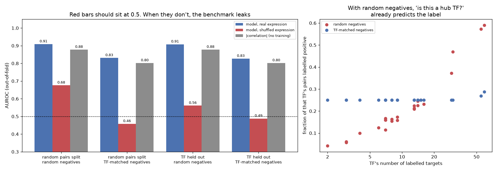

# GRN Link Prediction: Is Your Benchmark Leaking?

> A model trained on shuffled expression, with no biology left in it, scored AUROC 0.68. The fault was in the benchmark.

## Demo Output

Produced by `demo.py`. One gradient-boosting link predictor is evaluated under four protocols. Three scorers are compared: the model on real expression, the same model on expression shuffled gene by gene, and plain |correlation| with no training. Right: why random negatives leak.

## Why This Exists

Supervised GRN inference is a fast-growing genre: GNNs, transformers, contrastive pre-training. Each model learns a vector per gene and predicts whether a TF-target pair is a "real" edge, using ChIP-seq-derived labels. Three 2026 papers in this space are GP-DHT (*PLoS ONE*), scHGNN (*Funct Integr Genomics*) and GTGRNS (*IEEE TCBB*).

GP-DHT stands out because it reports how the evaluation protocol changes the answer:
- it splits cross-validation folds **by TF**, not by pair;
- it builds **TF-conditioned hard negatives**;
- it shows that easier random negatives inflate AUROC from about 0.83 to 0.88.

This repo makes that lesson something you can run, with a control that tells you whether your own benchmark leaks.

## The Leaks

| Leak | Mechanism | Fix |
|------|-----------|-----|
| **Hub TFs** | With uniform random negatives, a TF with 60 labelled targets has 60% positive pairs and a TF with 3 has 5% (right panel). Learning *which TF this is* predicts the label. | Draw negatives per TF, in proportion to its positives |
| **Popular targets** | Some genes are bound by many TFs, so they show up in many positives and few negatives. | Draw negatives from genes that *are* targets of other TFs |
| **Shared TFs across folds** | With a random pair split, every test TF was also seen in training, so its identity is learnable. | Hold out whole TFs (`GroupKFold`) |

## The Control Everyone Should Run

Shuffle each gene's values across cells, rebuild the features and rerun the whole evaluation. No regulatory signal survives, so an honest protocol gives AUROC of about 0.5. In the demo:

| Protocol | Shuffled-expression AUROC |
|----------|---------------------------|
| random pair split, random negatives | **0.68** (leaks) |
| TF held out, random negatives | 0.56 (gene-popularity leak remains) |
| TF held out, TF-matched negatives | 0.49 (clean) |

## What the Real Numbers Say

- Harder negatives cut the real model from AUROC 0.91 to 0.83. This matches the size of drop GP-DHT reports. Most of that drop also hits the no-training |correlation| baseline, so the negatives change the *task*, not just the model.
- Under the clean protocol, the model beats |correlation| by only ~0.03 AUROC. Always report a no-training baseline next to the model.

## When NOT to Use This

- **Unsupervised GRN methods** (GENIE3, SCENIC, PIDC) have no train/test split. Their risk is the label set itself; see BEELINE.
- **As a GRN method.** The simulator is linear and the model is a deliberately plain gradient-boosting classifier. The *evaluation code* is the point.

## The Uncomfortable Truth

ChIP-seq "negatives" are only unlabelled pairs. In this simulation, 30% of true edges are missing from the labels. A better model can therefore score *worse* by ranking real but unlabelled edges highly. Treat small AUROC gaps between methods as ties unless the protocol, negatives and baseline are all stated.

## Further Reading

- Yan S. et al. "GP-DHT: A dual-head transformer with supervised contrastive learning for shared-gene pretraining and single-cell GRN prediction." PLoS ONE (2026). doi:10.1371/journal.pone.0359164
- Zhang T. et al. "scHGNN: A single-cell gene regulatory network inference method based on heuristic graph neural networks." Functional & Integrative Genomics (2026).
- Gan Y. et al. "Inferring gene regulatory networks from single-cell transcriptomics jointly through graph neural networks and Transformer." IEEE TCBB (2026).
- Pratapa A. et al. "Benchmarking algorithms for gene regulatory network inference from single-cell transcriptomic data." Nature Methods (2020).
